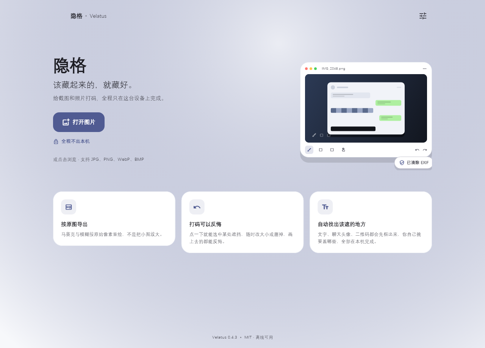
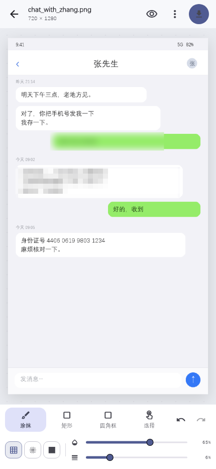
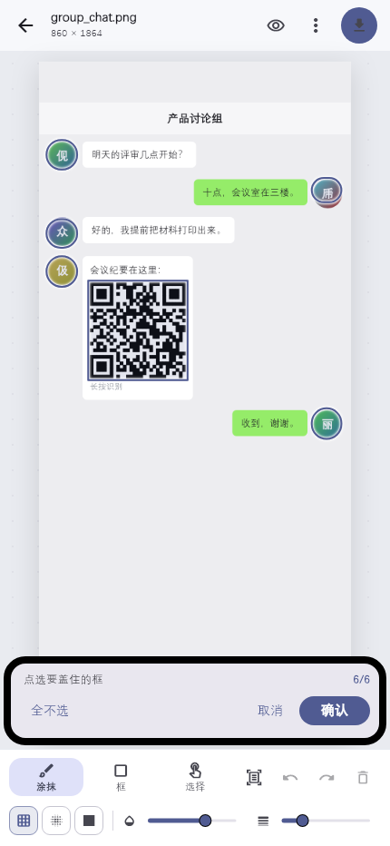
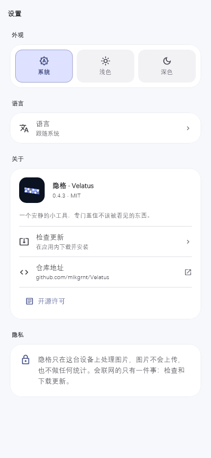

# Velatus

> [简体中文](README.zh-CN.md) · [繁體中文](README.zh-TW.md) · [English](README.md) · **Español** · [Français](README.fr.md)

[](https://github.com/mlkgrnt/Velatus/actions/workflows/ci.yml)
[](LICENSE)

**Velatus** (del latín *cubierto*), llamado **隐格** en chino, es una pequeña
herramienta local para tapar lo que no debería verse en una captura o una foto.
Nada se sube a ningún sitio: las máscaras se dibujan, editan y exportan en el
dispositivo.



## Por qué existe

Muchas apps fijan la máscara en cuanto la dibujas. Velatus guarda cada una como
un objeto: tócala para moverla, cambiar su tamaño, cambiar el estilo o borrarla,
y deshaz cualquier paso hasta el momento de exportar.

- **Dos gestos.** Pinta con el pincel o arrastra un recuadro. Un control
  redondea las esquinas; el rectángulo es solo ese control en cero.
- **Tres estilos.** Mosaico, desenfoque gaussiano o un color sólido con diez
  presets y un selector propio. La intensidad del desenfoque sigue el tamaño de
  la imagen, así que el archivo exportado coincide con la vista previa.
- **Selecciones que se portan bien.** Toca para añadir, toca otra vez para
  quitar. Al arrastrar una máscara de una selección múltiple solo se mueve esa;
  una esquina puede cruzar al otro lado y el recuadro cambia de cuadrante. El
  estilo, la intensidad, el radio y el color se aplican a toda la selección.
- **Deshacer, rehacer, comparar.** 60 pasos de historial; toca el ojo para fijar
  el original y vuelve a tocar para regresar (manteniéndolo ves el otro lado).
  Zoom con pellizco, rueda y doble toque, y arrastre con el botón central en
  escritorio.
- **Recuerda lo que usaste.** La herramienta y los parámetros de la última vez
  están listos al abrir la siguiente imagen, igual que el formato, la calidad y
  el destino de exportación.



## El análisis propone, tú decides

Analizar busca tres tipos de cosas y dibuja **candidatos con borde discontinuo**:
nunca aplica nada por su cuenta. Toca los recuadros que quieras tapar y pulsa
Confirmar. Después son máscaras normales. Un segundo análisis sustituye al
anterior en vez de apilar otra capa.

| | cómo |
| --- | --- |
| Texto | ML Kit chino + latino sin conexión, modelo incluido (**solo Android**) |
| Avatares de chat | Procesamiento de imagen en Dart puro: normalización adaptable del primer plano e imágenes integrales, forma por proyección (cuadrado, redondeado o circular), DFT de un bin para el ritmo de la columna y una plantilla semilla que recorre ambos márgenes simétricos para recuperar avatares que aparecen una sola vez |
| Códigos QR | `zxing2`, unos 200 KB de Dart puro, que calcula los límites reales del símbolo |

Dos avisos honestos: reconoce *texto*, no *texto sensible* — tú decides qué es
privado. Y la heurística de avatares puede pasar por alto diseños poco comunes.
Salvo el texto, los dos detectores funcionan también en Windows.



## Exportar

- A la resolución original, con las máscaras redibujadas sobre los píxeles de
  origen, nunca ampliando la vista previa.
- JPEG (calidad **100** por defecto) o PNG. **Los datos EXIF se eliminan
  siempre**, de modo que GPS, modelo del dispositivo y fecha no viajan con el
  archivo.
- Android: guardar en la galería o en Descargas. Escritorio: un diálogo nativo
  que se abre en la última carpeta usada. También se puede compartir.
- El formato, la calidad y el destino se recuerdan para la próxima.

## Privacidad

Todo ocurre en el dispositivo. Las imágenes nunca se suben y no se mide nada.
La aplicación se conecta por una sola función: buscar y descargar
actualizaciones. Consulta GitHub (con mirrors si no responde) y se puede omitir
por completo: el diálogo ofrece también un enlace normal a la página de
versiones.

## Idiomas y apariencia

Chino simplificado, chino tradicional, inglés, español y francés; claro, oscuro
o igual que el sistema. Fuera del chino la app se llama siempre Velatus: 隐格
solo aparece en la interfaz china.



## Descarga

Consigue la última versión en [Releases](https://github.com/mlkgrnt/Velatus/releases).

| archivo | para qué |
| --- | --- |
| `velatus-<versión>-android-arm64-v8a.apk` | casi cualquier móvil desde 2016: empieza aquí |
| `velatus-<versión>-android-armeabi-v7a.apk` | dispositivos de 32 bits más antiguos |
| `velatus-<versión>-windows.exe` | **un solo archivo**, sin instalar; ver abajo |
| `velatus-windows.zip` | la misma compilación de Windows en carpeta |

El exe de Windows es un lanzador portátil, no un instalador: la primera vez
descomprime el runtime de Flutter en `%LOCALAPPDATA%\Velatus\<versión>` y arranca
la app desde ahí; las siguientes veces abre directamente. No necesita permisos
de administrador ni deja archivos junto al exe. Como no está firmado,
SmartScreen puede avisar la primera vez; quien prefiera una carpeta tiene el
zip.

Todos los APK usan la misma clave pública de depuración, así que una versión
nueva se instala encima de la anterior. Desde 0.3.0 la app también puede
actualizarse sola desde Ajustes → Buscar actualizaciones.

## Compilar desde el código fuente

Flutter **3.50.1** / Dart **3.14.0** (o superior de la misma generación
estable), el Android SDK para Android y las herramientas de escritorio C++ de
Visual Studio para Windows.

```sh
flutter pub get
flutter gen-l10n           # solo tras editar lib/l10n/*.arb
flutter analyze
flutter test
flutter build apk --release --split-per-abi
flutter build windows --release
```

El exe de un solo archivo lo genera CI con
[`tool/windows_portable/package.ps1`](tool/windows_portable/package.ps1):
inserta la carpeta de release en un pequeño lanzador C# compilado con el
compilador de .NET Framework que incluye Windows. En local:

```powershell
./tool/windows_portable/package.ps1 `
  -ReleaseDir build/windows/x64/runner/Release `
  -Version 0.4.1 -Out velatus-0.4.1-windows.exe
```

Las capturas de `docs/screenshots/` se regeneran con
`flutter test --update-goldens tool/screenshots_test.dart`.

## Licencia

MIT: consulta [LICENSE](LICENSE).
