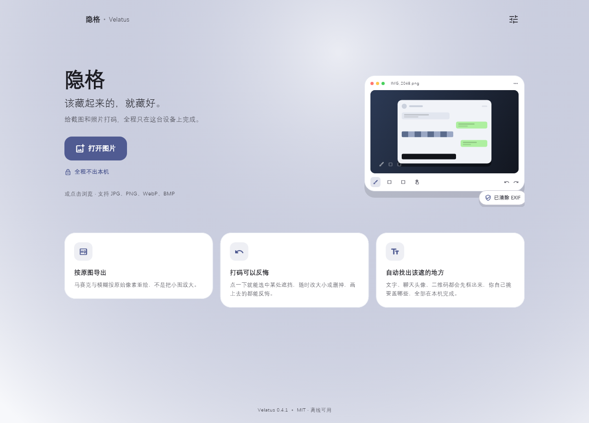
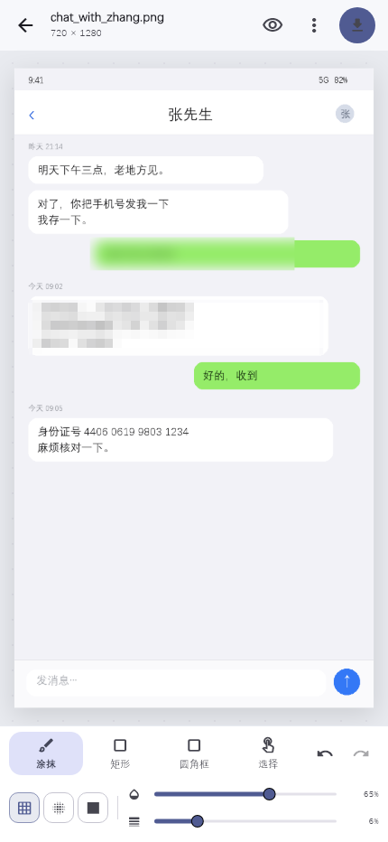
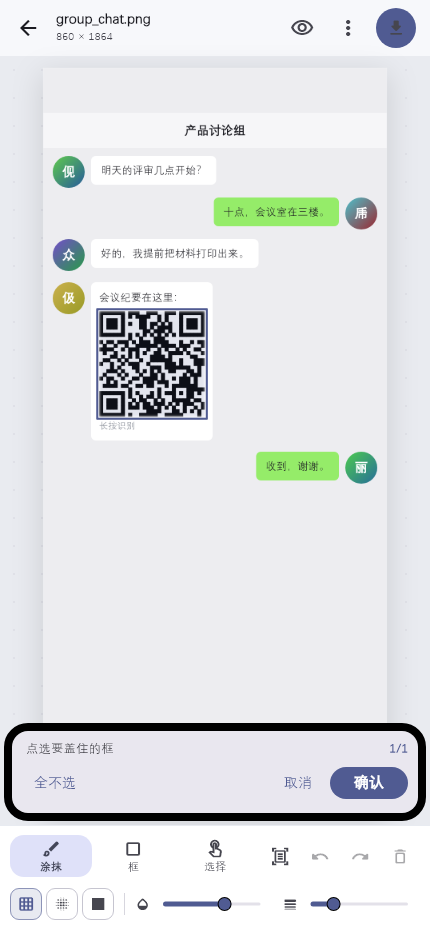
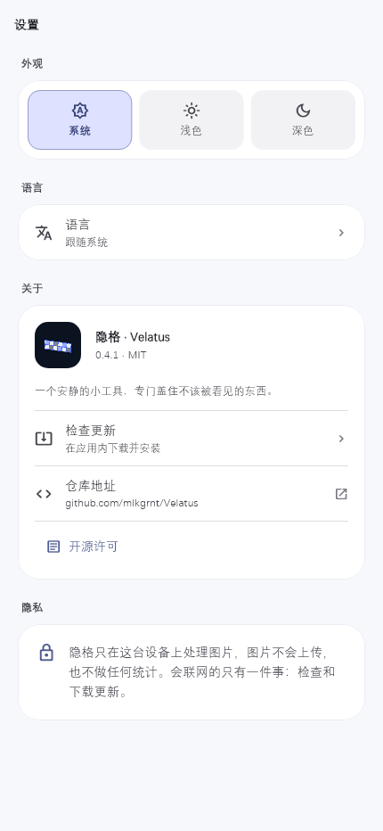

# Velatus

> [简体中文](README.zh-CN.md) · [繁體中文](README.zh-TW.md) · [English](README.md) · [Español](README.es.md) · **Français**

[](https://github.com/mlkgrnt/Velatus/actions/workflows/ci.yml)
[](LICENSE)

**Velatus** (du latin *couvert*), appelé **隐格** en chinois, est un petit outil
local pour masquer ce qui ne devrait pas être visible sur une capture d'écran
ou une photo. Rien n'est envoyé : les masques sont dessinés, modifiés et
exportés sur l'appareil.



## Pourquoi cet outil

La plupart des apps figent un masque dès qu'il est tracé. Velatus garde chacun
d'eux comme un objet : touchez-le pour le déplacer, le redimensionner, changer
son style ou le supprimer, et annulez tout jusqu'au moment de l'export.

- **Deux gestes.** Peignez au pinceau ou tracez un cadre. Un curseur arrondit
  les coins ; le rectangle n'est que ce curseur à zéro.
- **Trois rendus.** Mosaïque, flou gaussien ou aplat de couleur avec dix
  couleurs prédéfinies et un sélecteur libre. L'intensité du flou suit la taille
  de l'image : l'export est identique à l'aperçu.
- **Une sélection qui se tient.** Touchez pour ajouter, touchez encore pour
  retirer. Dans une sélection multiple, seul le masque sous le doigt se
  déplace ; un coin peut franchir le coin opposé pour basculer le cadre dans un
  autre quadrant. Style, intensité, arrondi et couleur s'appliquent à tout le
  groupe.
- **Annuler, rétablir, comparer.** 60 étapes d'historique ; maintenez l'œil pour
  voir l'original. Zoom au pincement, à la molette et au double toucher, défilement
  au bouton du milieu sur ordinateur.
- **Il se souvient.** L'outil et les paramètres utilisés sont déjà là à
  l'ouverture de l'image suivante, tout comme le format, la qualité et la
  destination de l'export.



## L'analyse propose, vous décidez

L'analyse cherche trois types d'éléments et dessine des **cadres candidats en
pointillés** : rien n'est appliqué tout seul. Touchez ceux à masquer puis
Confirmer. Ensuite, ce sont des masques ordinaires. Une seconde analyse remplace
la précédente au lieu d'empiler une couche de plus.

| | comment |
| --- | --- |
| Texte | ML Kit chinois + latin hors ligne, modèle intégré (**Android uniquement**) |
| Avatars de discussion | Heuristique locale : bloc carré sur fond uni, répété dans une même colonne |
| QR codes | `zxing2`, environ 200 Ko de Dart pur, qui calcule les limites réelles du symbole |

Deux précisions honnêtes : il reconnaît du *texte*, pas du *texte sensible* —
c'est vous qui décidez. Et l'heuristique d'avatars peut manquer des designs
inhabituels. Hormis le texte, les deux détecteurs fonctionnent aussi sous Windows.



## Exporter

- À la résolution d'origine, les masques étant redessinés sur les pixels source,
  sans agrandir l'aperçu.
- JPEG (qualité **100** par défaut) ou PNG. **Les EXIF sont toujours supprimés** :
  GPS, modèle d'appareil et date ne voyagent pas avec le fichier.
- Android : enregistrer dans la galerie ou dans Téléchargements. Ordinateur :
  une boîte de dialogue native qui s'ouvre dans le dernier dossier utilisé. Le
  partage système est aussi disponible.
- Format, qualité et destination sont mémorisés.

## Confidentialité

Tout se passe sur l'appareil. Les images ne sont jamais envoyées et rien n'est
mesuré. L'application n'accède au réseau que pour une seule fonction : chercher
et télécharger les mises à jour. Elle interroge GitHub (avec des miroirs s'il ne
répond pas) et cette étape peut être ignorée : la fenêtre propose aussi un
simple lien vers la page des versions.

## Langues et apparence

Chinois simplifié, chinois traditionnel, anglais, espagnol et français ; clair,
sombre ou comme le système. Hors de l'interface chinoise, l'app s'appelle
toujours Velatus : 隐格 n'apparaît qu'en chinois.



## Télécharger

Récupérez la dernière version sur [Releases](https://github.com/mlkgrnt/Velatus/releases).

| fichier | à quoi ça sert |
| --- | --- |
| `velatus-<version>-android-arm64-v8a.apk` | presque tous les téléphones depuis ~2016 : commencez ici |
| `velatus-<version>-android-armeabi-v7a.apk` | appareils 32 bits plus anciens |
| `velatus-<version>-windows.exe` | **un seul fichier**, sans installation ; voir ci-dessous |
| `velatus-windows.zip` | la même version Windows, en simple dossier |

L'exe Windows est un lanceur portable, pas un installateur : au premier
lancement il décompresse le runtime Flutter dans
`%LOCALAPPDATA%\Velatus\<version>` et démarre l'app depuis là ; ensuite il
ouvre directement. Aucun droit administrateur, aucun fichier à côté de l'exe.
Comme il n'est pas signé, SmartScreen peut avertir au premier lancement ; le
zip reste disponible pour qui préfère un dossier.

Tous les APK sont signés avec la même clé publique de débogage : une nouvelle
version s'installe par-dessus l'ancienne. Depuis 0.3.0, l'app peut aussi se
mettre à jour seule via Réglages → Rechercher des mises à jour.

## Compiler depuis les sources

Flutter **3.50.1** / Dart **3.14.0** (ou plus récent de la même génération
stable), le SDK Android pour Android et les outils C++ de Visual Studio pour
Windows.

```sh
flutter pub get
flutter gen-l10n           # seulement après avoir modifié lib/l10n/*.arb
flutter analyze
flutter test
flutter build apk --release --split-per-abi
flutter build windows --release
```

L'exe monofichier est produit par la CI avec
[`tool/windows_portable/package.ps1`](tool/windows_portable/package.ps1) :
il embarque le dossier de release dans un petit lanceur C# compilé avec le
compilateur .NET Framework fourni avec Windows. En local :

```powershell
./tool/windows_portable/package.ps1 `
  -ReleaseDir build/windows/x64/runner/Release `
  -Version 0.4.1 -Out velatus-0.4.1-windows.exe
```

Les captures de `docs/screenshots/` se régénèrent avec
`flutter test --update-goldens tool/screenshots_test.dart`.

## Licence

MIT : voir [LICENSE](LICENSE).
