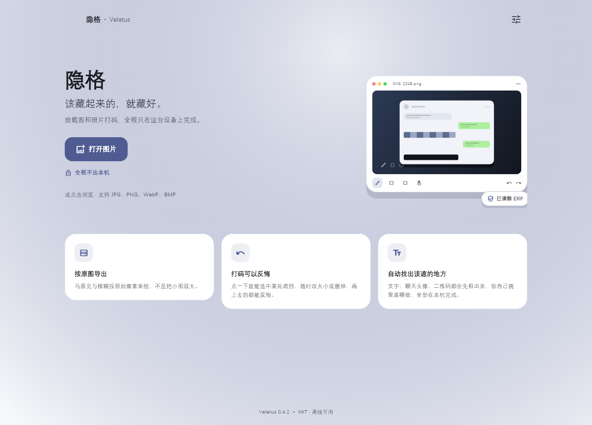
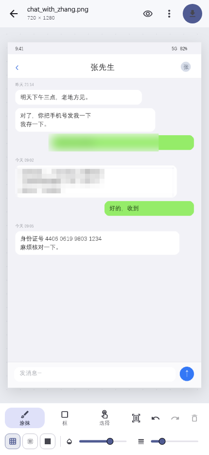
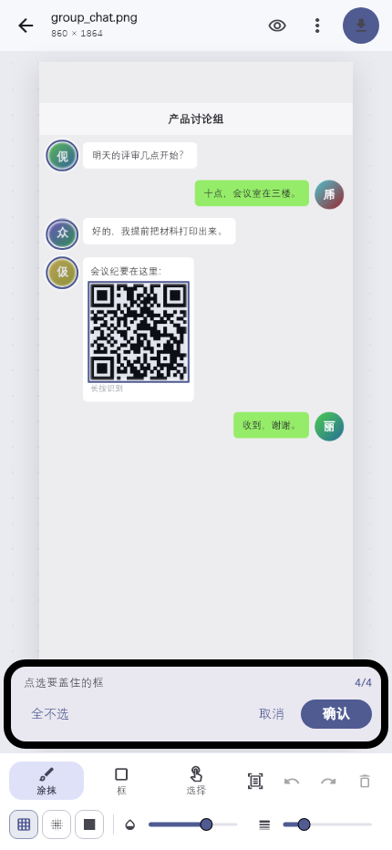
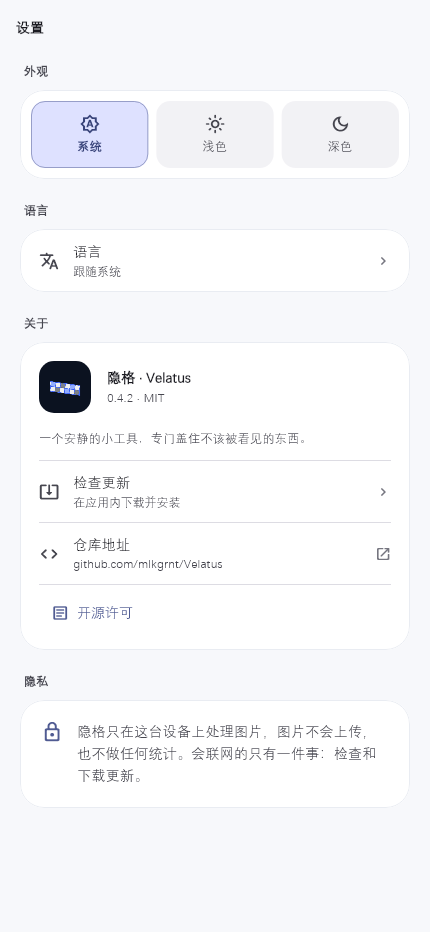

# Velatus

> [简体中文](README.zh-CN.md) · [繁體中文](README.zh-TW.md) · **English** · [Español](README.es.md) · [Français](README.fr.md)

[](https://github.com/mlkgrnt/Velatus/actions/workflows/ci.yml)
[](LICENSE)

**Velatus** (Latin for *covered*), called **隐格** in Chinese, is a small local
tool for covering the parts of a screenshot or photo that should not be seen.
Nothing is uploaded: masks are drawn, edited and exported on the device.



## Why it exists

Most redaction apps make you commit the moment you draw. Velatus keeps every
mask as an object, so you can tap one, move it, resize it, restyle it, or delete
it — and undo any of that — right up until you export.

- **Two gestures.** Paint with a brush, or drag a box. A box's corners can be
  rounded with a slider; a rectangle is just that slider at zero.
- **Three looks.** Mosaic, Gaussian blur, or a solid colour with ten presets
  and a custom picker. Blur strength follows the image size, so the exported
  file matches the preview.
- **Selections that behave.** Tap to add a mask, tap again to remove it.
  Dragging one mask out of a multi-selection moves only that one; a corner can
  be pulled past the opposite corner to flip the box into another quadrant.
  Style, strength, radius and colour apply to the whole selection at once.
- **Undo, redo, compare.** 60 steps of history. Tap the eye to pin the
  original on screen and tap again to return; hold it to peek at the other
  side. Pinch, wheel and double-tap zoom, middle-drag pan on desktop.
- **It remembers.** The tool and parameters you used last are there when you
  open the next picture. So is the export format, quality and destination.



## The scan proposes, you decide

Scan looks for three kinds of things and draws **outlined candidates** — it
never applies anything on its own. Tap the boxes you actually want to cover and
press Confirm. Confirmed boxes are ordinary masks afterwards. A second scan
replaces the previous set instead of piling another layer on top.

| | how |
| --- | --- |
| Text | ML Kit Chinese + Latin text recognition, bundled offline (**Android only**) |
| Chat avatars | Pure-Dart image processing: integral-image colour and edge contrast, projection shape checks (square, rounded or round), and a single-bin DFT that recovers the regular rhythm of a chat column |
| QR codes | `zxing2`, about 200 KB of pure Dart, finds the real symbol bounds |

Two honest notes: it recognises *text*, not *sensitive text* — you decide what
is private. And the avatar heuristic can miss unusual avatars. Both detectors
other than text work on Android and Windows.



## Export

- Full source resolution, with the masks redrawn at the original pixel grid —
  never a blown-up preview.
- JPEG (quality **100** by default) or PNG. **EXIF is always stripped**, so GPS,
  device model and timestamps do not travel with the file.
- Android: save to the gallery or to Downloads. Desktop: a native save dialog
  that reopens in the folder you used last. Share through the system sheet too.
- Format, quality and destination are remembered for next time.

## Privacy

Everything happens on the device. Images are never uploaded and there is no
analytics. The app has network access for exactly one feature: checking for and
downloading updates. That check talks to GitHub (with mirrors if GitHub is
unreachable) and can be skipped entirely — the download dialog also offers a
plain link to the release page.

## Languages and appearance

Simplified Chinese, Traditional Chinese, English, Spanish and French; light,
dark, or whatever the system is using. Outside Chinese the app is always called
Velatus — 隐格 only appears in the Chinese interface.



## Download

Grab the latest build from [Releases](https://github.com/mlkgrnt/Velatus/releases).

| file | what |
| --- | --- |
| `velatus-<version>-android-arm64-v8a.apk` | almost every phone from ~2016 onwards — start here |
| `velatus-<version>-android-armeabi-v7a.apk` | older 32-bit devices |
| `velatus-<version>-windows.exe` | **one file**, no install — see below |
| `velatus-windows.zip` | the same Windows build as a plain folder |

The Windows exe is a portable launcher, not an installer: on first run it
unpacks the Flutter runtime into `%LOCALAPPDATA%\Velatus\<version>` and launches
the app from there. Later runs start immediately. It needs no admin rights and
writes nothing next to itself. Because it is unsigned, Windows SmartScreen may
warn on first launch; the zip is there for anyone who prefers a plain folder.

All APKs are signed with the same public debug key, so a new version installs
straight over an old one. From 0.3.0 onwards the app can also update itself
from Settings → Check for updates.

## Build from source

Flutter **3.50.1** / Dart **3.14.0** (or newer, in the same stable generation),
plus the Android SDK for Android builds and Visual Studio's C++ desktop
toolchain for Windows.

```sh
flutter pub get
flutter gen-l10n           # only after editing lib/l10n/*.arb
flutter analyze
flutter test
flutter build apk --release --split-per-abi
flutter build windows --release
```

The portable exe is built in CI by
[`tool/windows_portable/package.ps1`](tool/windows_portable/package.ps1):
it embeds the release folder in a small C# launcher compiled with the .NET
Framework compiler that ships with Windows. To run it locally:

```powershell
./tool/windows_portable/package.ps1 `
  -ReleaseDir build/windows/x64/runner/Release `
  -Version 0.4.1 -Out velatus-0.4.1-windows.exe
```

Golden screenshots live in `docs/screenshots/` and are regenerated with
`flutter test --update-goldens tool/screenshots_test.dart`.

## License

MIT — see [LICENSE](LICENSE).
