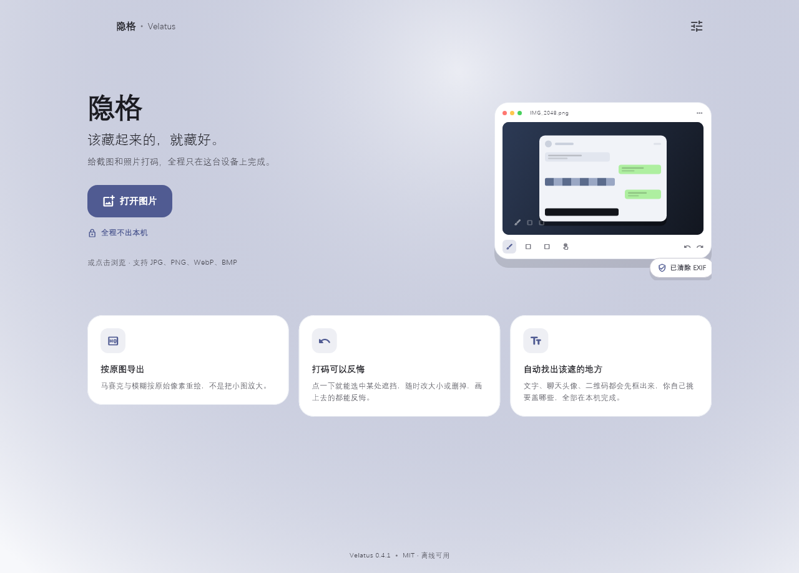
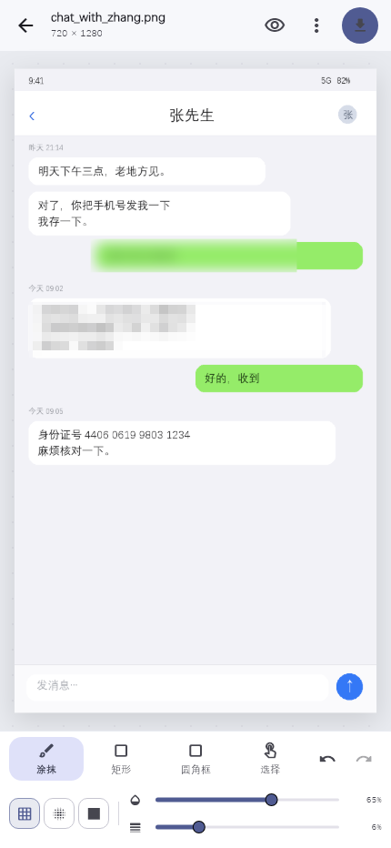
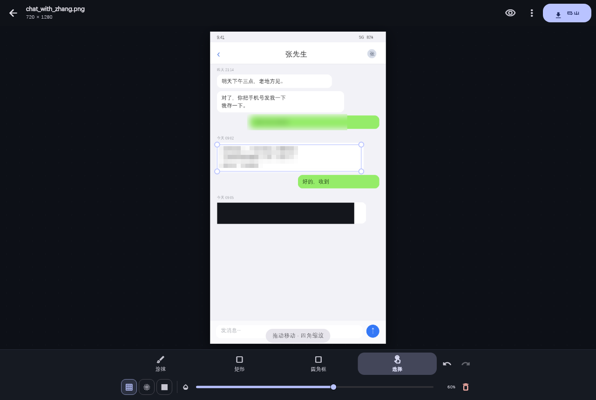

# 隐格 · Velatus

**该藏起来的，就藏好。**
本地优先的截图与照片打码工具，基于 Flutter 与 Material 3，支持 Android 和 Windows。

[English](README.md)

---

大部分打码应用把遮挡当成一笔画死的像素：手指一抬，唯一的退路只有撤销。
隐格把每一处遮挡都当成**可编辑的对象**——强度能改、能隐藏、能删掉，过一会儿
想起来还能回来调。预览和导出共用同一套渲染器，所以你看到的就是写进文件里的。

## 长什么样

<p align="center">
  
</p>

| 手机 | 桌面 |
|---|---|
|  |  |

手机上是一处模糊盖住手机号、一条马赛克盖住地址；桌面上再多一条色块。它们全都
还是可选中的图层，强度随时能改，也能一键删掉。

## 为什么还要做一个

- **图片不出本机。** Release 版不申请联网权限，没有账号、没有统计、没有云同步。
- **遮挡是对象，不是像素。** 马赛克、模糊、色块都是独立图层，各自带强度和形状。
- **文字识别离线完成。** Android 版内置 ML Kit 中英模型，一键找出文字块并盖住。
- **EXIF 天生被清掉。** 导出时从原始像素重新编码，GPS、机型、时间戳都留不下来。
- **任何分辨率都一致。** 遮挡尺寸按图片比例存储，4K 导出的效果和预览一致，不会糊成一团。
- **两种屏幕都顺手。** 手机底部工具坞、桌面常驻图层面板；Windows 支持滚轮缩放和快捷键。

## 功能

| | |
|---|---|
| 遮挡样式 | 马赛克、高斯模糊、纯色块 |
| 形状 | 涂抹、矩形、椭圆、自由套索 |
| 文字识别 | 一键检测、批量遮盖（Android，离线） |
| 编辑 | 撤销/重做、单层隐藏、删除、全部清除、按住对比原图 |
| 画布 | 双指缩放、滚轮缩放、双击缩放、中键拖拽平移 |
| 导出 | JPEG（质量 60–100）或 PNG，保存到相册或选择文件 |
| 隐私 | 无 `INTERNET` 权限、禁用备份、清除 EXIF |
| 界面 | Material 3、深色/浅色、English 与简体中文 |

## 安装

### Android

从 [Releases](../../releases) 下载 APK 安装，要求 Android 7.0（API 24）及以上。
第一次使用文字识别时，ML Kit 需要一秒左右加载内置模型。

### Windows

从 Releases 下载压缩包，解压后运行 `velatus.exe`，要求 Windows 10 及以上。

### 从源码构建

```bash
flutter pub get
flutter run -d android      # 或：flutter run -d windows
flutter build apk --release
flutter build windows --release
```

环境要求：Flutter 3.50+、Android SDK 36、JDK 21。Windows 构建需要装有
「使用 C++ 的桌面开发」工作负载的 Visual Studio 2022，以及 Windows 10/11 SDK。

## 实现说明

隐格在内存里保留两份图：一份最长边 2400px 的预览用于交互，一份原始文件用于导出。
导出时重新按全分辨率解码，把同一个 `CustomPainter` 重放进离屏 `Picture`，再编码。
马赛克的做法是先把原图缩进一张极小的离屏纹理，再用最近邻插值放大回来——既快，
又天然与分辨率无关。模糊用 `ImageFilter.blur`，sigma 由图片短边推导。

因为原图从未被改写，遮挡在导出的那一刻之前都是完全可逆的。

### 目录结构

```
lib/
  domain/        遮挡几何与命中测试
  services/      图片加载、渲染、导出、OCR、持久化
  features/
    home/        导入页与最近文件
    editor/      画布、控制器、工具栏、图层、导出面板
    settings/    主题、语言、隐私
  l10n/          ARB 文案与生成的本地化代码
```

## 隐私

隐格没有服务器。Android Release 清单里显式移除了 `INTERNET` 权限，即使代码里
误发请求也会失败。清单里还剩一条与网络相关的 `ACCESS_NETWORK_STATE`，由 ML Kit
声明，只能读取「当前有没有连接」，无法收发任何数据。

系统备份被禁用。导出重新编码像素，因此丢弃全部 EXIF 元数据，包括 GPS。

你可以自己验证：

```bash
aapt dump permissions build/app/outputs/flutter-apk/app-release.apk
```

## 路线图

- [ ] 工程文件（`.velatus`），一次编辑可以重新打开
- [ ] 批量处理与可复用的遮挡模板
- [ ] Windows 端通过内置 Tesseract 提供 OCR
- [ ] 更多语言（ARB 结构已就绪）
- [ ] 裁剪与旋转

## 参与

欢迎提 Issue 和 PR。提交前请跑一遍 `flutter analyze` 和 `flutter test`，CI 会检查。

## 许可

MIT，见 [LICENSE](LICENSE)。

Velatus 是拉丁语「被覆盖的」；中文名「隐格」取「把格子藏起来」的意思。
