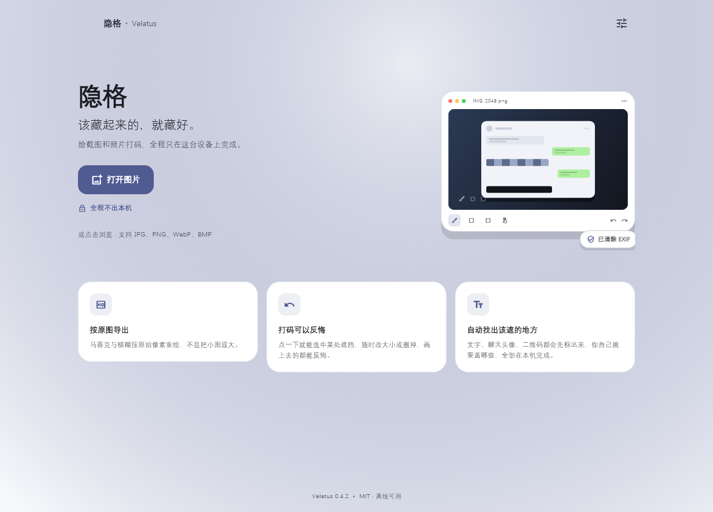
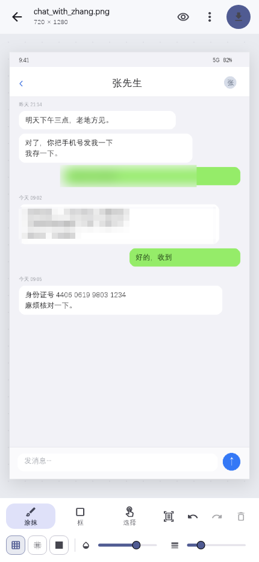
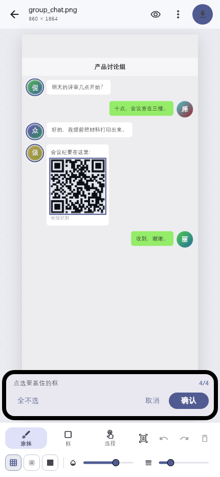
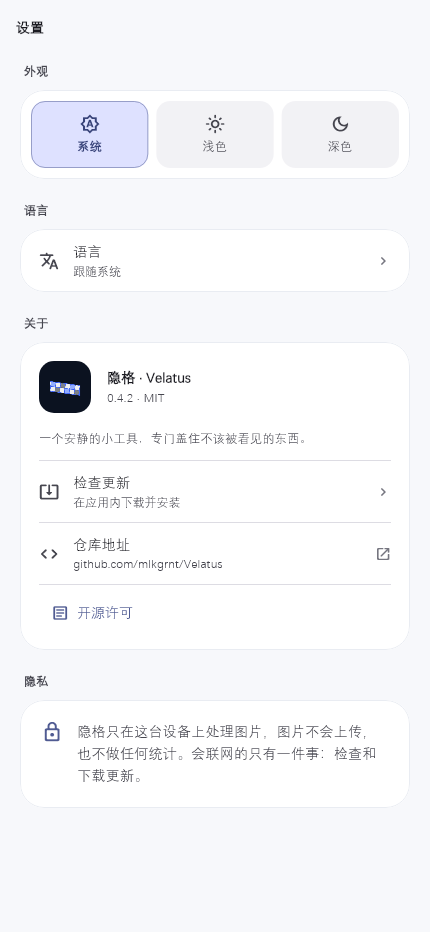

# 隱格 Velatus

> [简体中文](README.zh-CN.md) · **繁體中文** · [English](README.md) · [Español](README.es.md) · [Français](README.fr.md)

[](https://github.com/mlkgrnt/Velatus/actions/workflows/ci.yml)
[](LICENSE)

**隱格**（拉丁語 Velatus，意思是「被覆蓋的」）是替截圖和照片打碼的小工具，
全程只在這一台裝置上完成，圖片不會上傳。



## 為什麼做它

很多打碼工具一畫下去就定死了。隱格把每一處遮擋都當成可以改的物件：點一下
選取，就能移動、縮放、換樣式或刪掉，匯出之前隨時可以反悔。

- **兩種手勢**：用筆刷塗抹，或拖出一個框。框的四角可以用圓角滑桿磨圓，直角
  只是把圓角調到零，所以不會有兩個長得幾乎一樣的工具。
- **三種效果**：馬賽克、高斯模糊、色塊。色塊有 10 組預設，也能自己調顏色。
  模糊強度會隨圖片尺寸縮放，匯出和預覽看起來一致。
- **選取真的好用**：點一下加選，再點一下取消。多選時拖曳只移動你碰到的那個
  框，角點拉過對角點可以直接翻到另一個象限；改強度、樣式、圓角、顏色時，
  整組一起生效。
- **復原、重做、對比**：60 步歷程；點一下眼睛固定看原圖，再點一下回到打碼後，
  按住則臨時預覽另一側。雙指、滾輪、雙擊都能縮放，桌面端還能用中鍵拖曳畫布。
- **記得上一次**：開啟新圖片時，上次用的工具和參數還在；匯出用的格式、
  品質、儲存位置也一樣。



## 掃描先給框，你來挑

掃描會找出三類東西，只畫**虛線候選框**，不會自己蓋上去。點選要蓋住的框，
按「確認」才生效；確認之後就是普通的遮擋，仍然可以隨便改。再掃一次會取代
上一次的候選，不會一層層疊上去。

| | 做法 |
| --- | --- |
| 文字 | ML Kit 中英文離線文字辨識，模型打包在應用程式裡（**僅 Android**） |
| 聊天大頭貼 | 純 Dart 影像處理：積分圖算色彩與邊緣對比、投影判斷方形/圓角/圓形，再用單頻 DFT 找回聊天欄的重複節奏 |
| QR 碼 | `zxing2`，約 200 KB 的純 Dart 程式，框住的是 QR 碼本體 |

兩句實話：它辨識的是「文字」，不是「敏感文字」，哪些該遮由你決定；大頭貼
是啟發式，遇到特別的圖案可能會漏。文字以外的兩種偵測在 Android 和
Windows 上都能用。



## 匯出

- 按原圖解析度匯出，遮擋按原始像素重繪，不是把預覽小圖放大。
- JPEG（品質預設 **100**）或 PNG。**EXIF 一定會被清除**，定位、機型、時間
  不會跟著圖片一起出去。
- Android 可存到相簿或 Download 資料夾；桌面端用系統儲存對話框，下次會直接
  回到上次用的資料夾。也能直接呼叫系統分享。
- 格式、品質、儲存位置都會記住。

## 隱私

所有處理都在本機完成。圖片不會上傳，也不做任何統計。應用程式唯一會連網的
地方是檢查和下載更新：優先訪問 GitHub，連不上時會換鏡像；不想用也沒關係，
更新視窗裡同樣給了開啟發佈頁的一般連結。

## 語言和外觀

简体中文、繁體中文、English、Español、Français；淺色、深色，或跟系統一樣。
只有中文介面會顯示「隱格」，其它語言一律叫 Velatus。



## 下載

到 [Releases](https://github.com/mlkgrnt/Velatus/releases) 下載最新版。

| 檔案 | 說明 |
| --- | --- |
| `velatus-<版本>-android-arm64-v8a.apk` | 2016 年之後的手機基本都是這個，先試它 |
| `velatus-<版本>-android-armeabi-v7a.apk` | 老一點的 32 位裝置 |
| `velatus-<版本>-windows.exe` | **單一檔案**，不用安裝，見下面 |
| `velatus-windows.zip` | 同樣的 Windows 版本，一般資料夾形式 |

那個 Windows exe 是便攜啟動器，不是安裝程式：第一次執行會把 Flutter 執行庫
解開到 `%LOCALAPPDATA%\Velatus\<版本>`，再從那裡啟動；之後再開就是直接
啟動。不需要管理員權限，也不會在 exe 旁邊留下一堆檔案。因為沒有簽章，
Windows SmartScreen 首次執行可能會提醒一下；不放心的人可以下載 zip 自己
解壓。

所有 APK 都用同一個公開的 debug 簽章，新版可以直接覆蓋安裝。從 0.3.0 起，
也能在「設定 → 檢查更新」裡讓應用程式自己更新。

## 從原始碼建置

Flutter **3.50.1** / Dart **3.14.0**（或同一穩定世代的更新版本）。建置 Android
需要 Android SDK，建置 Windows 需要 Visual Studio 的 C++ 桌面工具鏈。

```sh
flutter pub get
flutter gen-l10n           # 改過 lib/l10n/*.arb 之後才需要
flutter analyze
flutter test
flutter build apk --release --split-per-abi
flutter build windows --release
```

單檔 exe 由 CI 用
[`tool/windows_portable/package.ps1`](tool/windows_portable/package.ps1) 產生：
把整個 release 資料夾塞進一個很小的 C# 啟動器，編譯器用的是 Windows 內建的
.NET Framework 編譯器。本機也能自己跑：

```powershell
./tool/windows_portable/package.ps1 `
  -ReleaseDir build/windows/x64/runner/Release `
  -Version 0.4.1 -Out velatus-0.4.1-windows.exe
```

`docs/screenshots/` 裡的截圖用
`flutter test --update-goldens tool/screenshots_test.dart` 重新產生。

## 授權

MIT，見 [LICENSE](LICENSE)。
